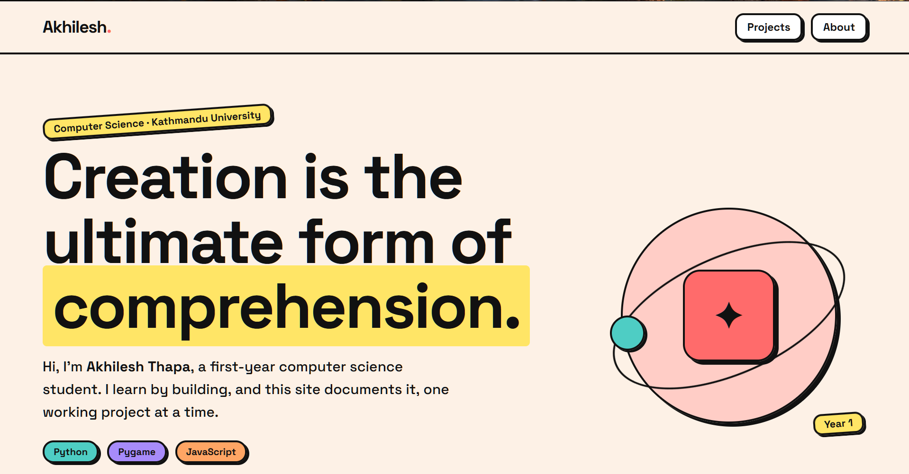
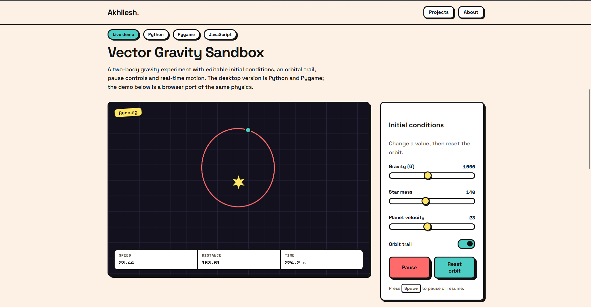

# akhileshthapa.me

Personal portfolio of **Akhilesh Thapa**, a computer science student at Kathmandu University. It documents what I build while learning, one working project at a time.

**Live site: [akhileshthapa.me](https://akhileshthapa.me)**





## What's on the site

- **Vector Gravity Sandbox**: a two-body gravity simulation. The original is written in Python and Pygame ([`gravity.py`](projects/gravity-sandbox/gravity.py)); the site has a playable browser port of the same physics where you can change gravity, star mass and launch speed and watch the orbit react.
- More projects will be added over time.

## Built with

- HTML, CSS and vanilla JavaScript. No framework, no build step, no dependencies.
- A hand-written neo-brutalist component set (thick borders, hard shadows, bold colours) driven by CSS variables.
- Hosted on GitHub Pages with a custom domain.

The design goals were simple: easy to read, easy to extend, and easy for a beginner to maintain.

## Run it locally

```bash
git clone https://github.com/ak-5l/ak-5l.github.io.git
cd ak-5l.github.io
python -m http.server 8000
```

Then open http://localhost:8000. You can also open `index.html` directly in a browser.

To run the original Python simulator:

```bash
pip install pygame
python projects/gravity-sandbox/gravity.py
```

Controls: edit the values in the side panel and click **Apply & Reset**; press **Space** to pause.

## Project structure

```
index.html                  page shell, intro and about text
assets/css/theme.css        design tokens and reusable components
assets/css/site.css         page layout
assets/js/data/content.js   projects and contact links (the one file to edit for content)
assets/js/render.js         renders content.js into the page
assets/js/demos/            interactive demos, one file each
projects/                   downloadable source for each project
docs/MAINTAINING.md         how to add projects, add demos and change the look
```

## Contributing

This is a personal site, so I'm not looking for code contributions. If you spot a bug, a typo or an accessibility problem, please [open an issue](../../issues).

## Contact

GitHub: [@ak-5l](https://github.com/ak-5l)
